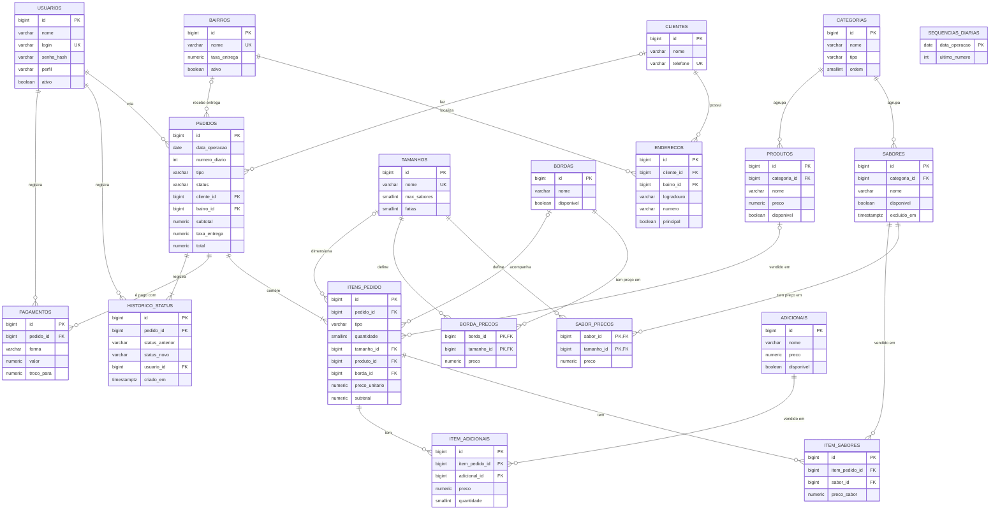

# Modelagem do Banco de Dados — Pizzeria OMS

> **Status:** v0.2 — baseado em `docs/escopo.md` v0.2. Banco: PostgreSQL.

## 1. Diagrama entidade-relacionamento



O diagrama mostra as colunas principais. O dicionário completo está na seção 4.

## 2. Convenções

| Tema | Decisão | Motivo |
|---|---|---|
| Nomes | `snake_case`, tabelas no plural, em português | Alinhado ao domínio e ao escopo |
| Chave primária | `bigint GENERATED ALWAYS AS IDENTITY` | Simples, eficiente e suficiente para o volume de uma pizzaria |
| Dinheiro | `NUMERIC(10,2)` no banco e `Decimal` no Python | **Nunca `float`**: 0.1 + 0.2 ≠ 0.3 em ponto flutuante |
| Datas e horas | `TIMESTAMPTZ`, gravado em UTC | Exibição convertida para `America/Sao_Paulo` |
| Enums | `VARCHAR` + `CHECK` constraint | Enums nativos do Postgres são difíceis de alterar em migrations |
| Exclusão | Lógica, via `excluido_em` (RN-08) | Preserva o histórico de pedidos |
| Pausa | Campo `disponivel` (RN-07) | Pausar é diferente de excluir: o item volta amanhã |
| Auditoria | `criado_em` em todas as tabelas, `atualizado_em` nas mutáveis | Rastreabilidade |

## 3. Decisões de modelagem

### 3.1 Preço por sabor e tamanho (`sabor_precos`)

O preço não fica na tabela `sabores`, porque varia por tamanho (RN-03). A tabela `sabor_precos` tem uma linha por combinação sabor × tamanho. **A ausência de uma linha significa que o sabor não é vendido naquele tamanho** (ex.: um sabor especial que não existe em broto). A mesma lógica vale para `borda_precos` (RN-05).

### 3.2 Snapshot de dados no pedido (RN-12 e RN-28)

O pedido registra uma **fotografia** de tudo no momento da venda: nomes e preços dos produtos, sabores, bordas e adicionais, além do endereço de entrega e da taxa do bairro. As chaves estrangeiras continuam existindo para relatórios ("quantas calabresas vendemos?"), mas **nenhum cálculo ou exibição de um pedido antigo depende do cardápio atual**.

Isso protege contra três situações reais: o dono reajusta preços, renomeia um sabor ou o cliente muda de endereço. Em todos os casos, os pedidos e fechamentos antigos continuam corretos.

### 3.3 Um item de pizza, vários sabores

Cada pizza é **uma linha** em `itens_pedido`, e seus sabores ficam em `item_sabores`, cada um com o preço que tinha naquele tamanho. O `preco_base` do item é o maior desses preços (RN-04). Guardar o preço de cada sabor permite auditar o cálculo e, se a regra mudar para média no futuro, os dados já estão lá.

### 3.4 Status atual + histórico

O status atual fica em `pedidos.status` para consultas rápidas (ex.: a fila da cozinha), e cada transição é gravada em `historico_status` (RN-17). As duas escritas acontecem **na mesma transação**, então nunca ficam inconsistentes. O histórico também permite calcular métricas futuras, como o tempo médio entre `EM_PREPARO` e `PRONTO`.

### 3.5 Dia de operação e número diário (RN-11 e RN-27)

Uma pizzaria normalmente vira a meia-noite aberta. Um pedido feito às 00h30 de sábado pertence ao **expediente de sexta**. Por isso o pedido tem o campo `data_operacao`, calculado com uma hora de corte configurável (`HORA_CORTE_DIA`, padrão 06:00): pedidos antes do corte pertencem ao dia anterior. O fechamento do dia (RN-25) usa esse campo, e não a data do calendário.

O número diário vem da tabela `sequencias_diarias`, incrementada de forma **atômica** em um único comando, o que evita dois pedidos com o mesmo número quando dois atendentes criam pedidos ao mesmo tempo:

```sql
INSERT INTO sequencias_diarias (data_operacao, ultimo_numero)
VALUES (:data_operacao, 1)
ON CONFLICT (data_operacao)
DO UPDATE SET ultimo_numero = sequencias_diarias.ultimo_numero + 1
RETURNING ultimo_numero;
```

A constraint `UNIQUE (data_operacao, numero_diario)` em `pedidos` é a última linha de defesa.

### 3.6 Onde cada regra é garantida

Regras que dependem só da própria linha viram **constraints no banco**. Regras que cruzam tabelas ou dependem de contexto (perfil do usuário, estado atual) ficam na **camada de serviço** do backend, com testes automatizados.

## 4. Dicionário de dados

Legenda: **NN** = NOT NULL · **UK** = único · **FK** = chave estrangeira.

### 4.1 `usuarios`

| Coluna | Tipo | Restrições | Descrição |
|---|---|---|---|
| id | bigint | PK | |
| nome | varchar(100) | NN | |
| login | varchar(50) | NN, UK | |
| senha_hash | varchar(255) | NN | Hash bcrypt/argon2, nunca a senha (RNF-03) |
| perfil | varchar(20) | NN, CHECK in (`ADMIN`, `ATENDENTE`, `COZINHA`, `ENTREGADOR`) | |
| ativo | boolean | NN, default `true` | Usuário desativado não faz login |
| criado_em | timestamptz | NN, default `now()` | |

### 4.2 `categorias`

| Coluna | Tipo | Restrições | Descrição |
|---|---|---|---|
| id | bigint | PK | |
| nome | varchar(60) | NN | Ex.: Tradicionais, Especiais, Doces, Bebidas |
| tipo | varchar(10) | NN, CHECK in (`PIZZA`, `PRODUTO`) | Define se agrupa sabores ou produtos simples |
| ordem | smallint | NN, default 0 | Ordem de exibição no PDV |
| excluido_em | timestamptz | | Exclusão lógica |

### 4.3 `tamanhos`

| Coluna | Tipo | Restrições | Descrição |
|---|---|---|---|
| id | bigint | PK | |
| nome | varchar(30) | NN, UK | Broto, Média, Grande, Família |
| max_sabores | smallint | NN, CHECK ≥ 1 | RN-02 |
| fatias | smallint | | Informativo |
| ordem | smallint | NN, default 0 | |
| disponivel | boolean | NN, default `true` | |
| excluido_em | timestamptz | | |

### 4.4 `sabores`

| Coluna | Tipo | Restrições | Descrição |
|---|---|---|---|
| id | bigint | PK | |
| categoria_id | bigint | NN, FK → categorias | Categoria do tipo `PIZZA` |
| nome | varchar(80) | NN | |
| descricao | text | | Ingredientes |
| disponivel | boolean | NN, default `true` | RN-07 |
| excluido_em | timestamptz | | RN-08 |
| criado_em / atualizado_em | timestamptz | NN | |

### 4.5 `sabor_precos`

| Coluna | Tipo | Restrições | Descrição |
|---|---|---|---|
| sabor_id | bigint | PK, FK → sabores | |
| tamanho_id | bigint | PK, FK → tamanhos | |
| preco | numeric(10,2) | NN, CHECK ≥ 0 | RN-03 |

### 4.6 `bordas` e `borda_precos`

Mesma estrutura de `sabores` (sem `categoria_id` e `descricao`) e `sabor_precos`. RN-05.

### 4.7 `adicionais`

| Coluna | Tipo | Restrições | Descrição |
|---|---|---|---|
| id | bigint | PK | |
| nome | varchar(60) | NN | Ex.: Bacon extra, Catupiry |
| preco | numeric(10,2) | NN, CHECK ≥ 0 | Preço único no MVP, independente do tamanho |
| disponivel | boolean | NN, default `true` | |
| excluido_em | timestamptz | | |

### 4.8 `produtos`

| Coluna | Tipo | Restrições | Descrição |
|---|---|---|---|
| id | bigint | PK | |
| categoria_id | bigint | NN, FK → categorias | Categoria do tipo `PRODUTO` |
| nome | varchar(80) | NN | Ex.: Coca-Cola 2L |
| descricao | text | | |
| preco | numeric(10,2) | NN, CHECK ≥ 0 | RN-01 |
| disponivel | boolean | NN, default `true` | |
| excluido_em | timestamptz | | |

### 4.9 `bairros`

| Coluna | Tipo | Restrições | Descrição |
|---|---|---|---|
| id | bigint | PK | |
| nome | varchar(80) | NN, UK | |
| taxa_entrega | numeric(10,2) | NN, CHECK ≥ 0 | RN-19 |
| ativo | boolean | NN, default `true` | Bairro inativo não aceita entrega (RN-20) |

### 4.10 `clientes`

| Coluna | Tipo | Restrições | Descrição |
|---|---|---|---|
| id | bigint | PK | |
| nome | varchar(100) | NN | |
| telefone | varchar(20) | NN, UK | Somente dígitos, normalizado antes de gravar (US-02) |
| criado_em | timestamptz | NN | |

### 4.11 `enderecos`

| Coluna | Tipo | Restrições | Descrição |
|---|---|---|---|
| id | bigint | PK | |
| cliente_id | bigint | NN, FK → clientes | |
| bairro_id | bigint | NN, FK → bairros | |
| logradouro | varchar(150) | NN | |
| numero | varchar(10) | NN | Texto: aceita "S/N", "120-A" |
| complemento | varchar(100) | | |
| referencia | varchar(150) | | Ex.: "portão azul" |
| principal | boolean | NN, default `false` | Endereço sugerido no PDV |

### 4.12 `sequencias_diarias`

| Coluna | Tipo | Restrições | Descrição |
|---|---|---|---|
| data_operacao | date | PK | |
| ultimo_numero | int | NN | Ver seção 3.5 |

### 4.13 `pedidos`

| Coluna | Tipo | Restrições | Descrição |
|---|---|---|---|
| id | bigint | PK | Interno, não exibido (RN-11) |
| data_operacao | date | NN | Ver seção 3.5 (RN-27) |
| numero_diario | int | NN | #001, #002... |
| tipo | varchar(10) | NN, CHECK in (`RETIRADA`, `ENTREGA`) | RN-09 |
| status | varchar(20) | NN, CHECK in (estados da RN-15) | Status atual |
| cliente_id | bigint | FK → clientes | Opcional em retirada |
| nome_cliente | varchar(100) | | Snapshot, ou nome informado na retirada |
| telefone_cliente | varchar(20) | | Snapshot |
| bairro_id | bigint | FK → bairros | Só entrega |
| bairro_nome | varchar(80) | | Snapshot (RN-28) |
| logradouro, numero, complemento, referencia | varchar | | Snapshot do endereço (RN-28) |
| subtotal | numeric(10,2) | NN, CHECK ≥ 0 | Soma dos itens |
| taxa_entrega | numeric(10,2) | NN, default 0 | Snapshot da taxa do bairro (RN-28) |
| total | numeric(10,2) | NN, CHECK = subtotal + taxa_entrega | RN-13 |
| observacao | text | | |
| motivo_cancelamento | text | | RN-16 |
| criado_por | bigint | NN, FK → usuarios | |
| criado_em / atualizado_em | timestamptz | NN | |

Constraints adicionais:

```sql
UNIQUE (data_operacao, numero_diario);

-- RN-10: entrega exige cliente e endereço
CHECK (tipo <> 'ENTREGA' OR (cliente_id IS NOT NULL AND bairro_id IS NOT NULL AND logradouro IS NOT NULL));

-- RN-16: cancelamento exige motivo
CHECK (status <> 'CANCELADO' OR motivo_cancelamento IS NOT NULL);
```

Índices: `(data_operacao)` para o fechamento; índice parcial em `(status)` para pedidos ativos (`WHERE status NOT IN ('RETIRADO', 'ENTREGUE', 'CANCELADO')`), usado pela fila da cozinha.

### 4.14 `itens_pedido`

| Coluna | Tipo | Restrições | Descrição |
|---|---|---|---|
| id | bigint | PK | |
| pedido_id | bigint | NN, FK → pedidos (ON DELETE CASCADE) | |
| tipo | varchar(10) | NN, CHECK in (`PIZZA`, `PRODUTO`) | |
| quantidade | smallint | NN, CHECK > 0 | |
| tamanho_id / tamanho_nome | bigint / varchar | FK / snapshot | Só pizza |
| produto_id / produto_nome | bigint / varchar | FK / snapshot | Só produto |
| borda_id / borda_nome | bigint / varchar | FK / snapshot | Opcional, só pizza |
| preco_base | numeric(10,2) | NN | Sabor mais caro (RN-04) ou preço do produto |
| preco_borda | numeric(10,2) | NN, default 0 | |
| preco_unitario | numeric(10,2) | NN | base + borda + adicionais |
| subtotal | numeric(10,2) | NN | preco_unitario × quantidade |
| observacao | text | | RN-06 |

```sql
-- Coerência do tipo de item
CHECK (
  (tipo = 'PIZZA'   AND tamanho_id IS NOT NULL AND produto_id IS NULL) OR
  (tipo = 'PRODUTO' AND produto_id IS NOT NULL AND tamanho_id IS NULL AND borda_id IS NULL)
);
```

### 4.15 `item_sabores`

| Coluna | Tipo | Restrições | Descrição |
|---|---|---|---|
| id | bigint | PK | |
| item_pedido_id | bigint | NN, FK → itens_pedido (ON DELETE CASCADE) | |
| sabor_id | bigint | NN, FK → sabores | |
| sabor_nome | varchar(80) | NN | Snapshot |
| preco_sabor | numeric(10,2) | NN | Preço do sabor no tamanho, no momento da venda |

`UNIQUE (item_pedido_id, sabor_id)`.

### 4.16 `item_adicionais`

| Coluna | Tipo | Restrições | Descrição |
|---|---|---|---|
| id | bigint | PK | |
| item_pedido_id | bigint | NN, FK → itens_pedido (ON DELETE CASCADE) | |
| adicional_id | bigint | NN, FK → adicionais | |
| adicional_nome | varchar(60) | NN | Snapshot |
| preco | numeric(10,2) | NN | Snapshot |
| quantidade | smallint | NN, default 1, CHECK > 0 | |

### 4.17 `pagamentos`

| Coluna | Tipo | Restrições | Descrição |
|---|---|---|---|
| id | bigint | PK | |
| pedido_id | bigint | NN, FK → pedidos | |
| forma | varchar(10) | NN, CHECK in (`DINHEIRO`, `PIX`, `CREDITO`, `DEBITO`) | RN-21 |
| valor | numeric(10,2) | NN, CHECK > 0 | |
| troco_para | numeric(10,2) | | RN-23 |
| registrado_por | bigint | NN, FK → usuarios | |
| criado_em | timestamptz | NN | |

```sql
-- RN-23: troco só em dinheiro, e nunca menor que o valor
CHECK (troco_para IS NULL OR (forma = 'DINHEIRO' AND troco_para >= valor));
```

O troco (`troco_para - valor`) é calculado, não armazenado.

### 4.18 `historico_status`

| Coluna | Tipo | Restrições | Descrição |
|---|---|---|---|
| id | bigint | PK | |
| pedido_id | bigint | NN, FK → pedidos | |
| status_anterior | varchar(20) | | Nulo na criação do pedido |
| status_novo | varchar(20) | NN | |
| usuario_id | bigint | NN, FK → usuarios | |
| observacao | text | | Motivo, no caso de cancelamento |
| criado_em | timestamptz | NN | RN-17 |

## 5. Rastreabilidade: regra → onde é garantida

| Regra | Banco (constraint) | Serviço (backend) |
|---|---|---|
| RN-02 Máx. de sabores por tamanho | | ✔ conta `item_sabores` × `tamanhos.max_sabores` |
| RN-03 Sabor disponível no tamanho | | ✔ exige linha em `sabor_precos` |
| RN-04 Preço pelo sabor mais caro | | ✔ cálculo de `preco_base` |
| RN-07 Item pausado não é vendido | | ✔ valida `disponivel` |
| RN-08 Exclusão lógica | ✔ FKs impedem exclusão física | ✔ preenche `excluido_em` |
| RN-10 Entrega exige endereço | ✔ CHECK em `pedidos` | ✔ mensagem amigável |
| RN-11 Número diário único | ✔ UNIQUE + sequência atômica | |
| RN-12 Preço congelado na venda | ✔ colunas de snapshot | ✔ copia valores na criação |
| RN-13 Total do pedido | ✔ CHECK `total` | ✔ cálculo |
| RN-14 Edição só em `RECEBIDO` | | ✔ |
| RN-15 Transições válidas | ✔ CHECK dos valores possíveis | ✔ máquina de estados |
| RN-16 Motivo de cancelamento | ✔ CHECK em `pedidos` | ✔ |
| RN-17 Histórico de status | | ✔ mesma transação da mudança |
| RN-20 Bairro cadastrado e ativo | ✔ FK | ✔ valida `ativo` |
| RN-22 Soma dos pagamentos = total | | ✔ exigida ao finalizar (`RETIRADO`/`ENTREGUE`) |
| RN-23 Troco só em dinheiro | ✔ CHECK em `pagamentos` | ✔ cálculo do troco |
| RN-25/26 Fechamento do dia | | ✔ consulta por `data_operacao` |
| RN-27 Dia de operação | | ✔ cálculo de `data_operacao` com `HORA_CORTE_DIA` |
| RN-28 Endereço e taxa congelados | ✔ colunas de snapshot | ✔ copia valores na criação |

## 6. Histórico de versões

- **v0.1** — Modelagem inicial. Revelou duas regras novas (RN-27 e RN-28) e o esclarecimento da RN-22.
- **v0.2** — Alinhada ao `escopo.md` v0.2, que já incorpora essas regras. RN-27 e RN-28 adicionadas à tabela de rastreabilidade.
